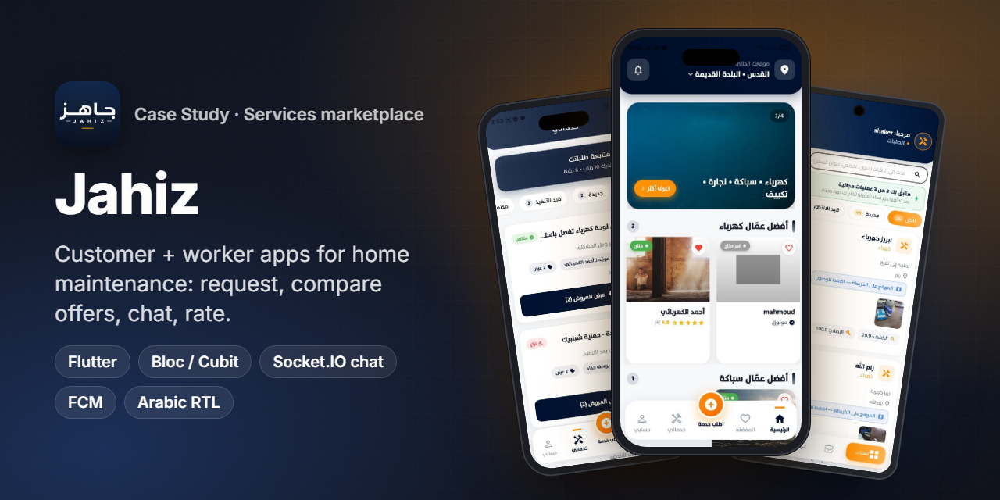
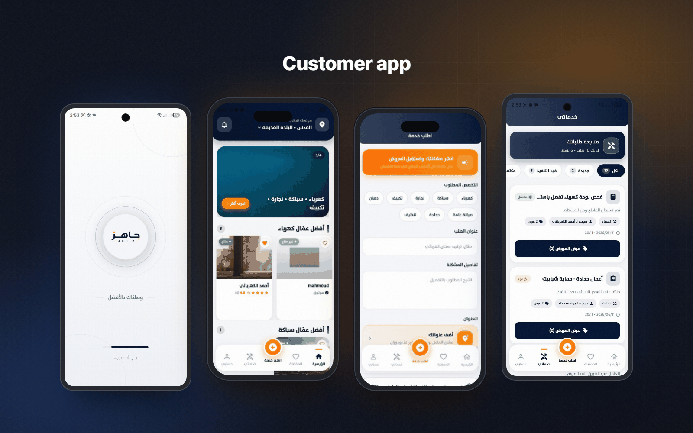
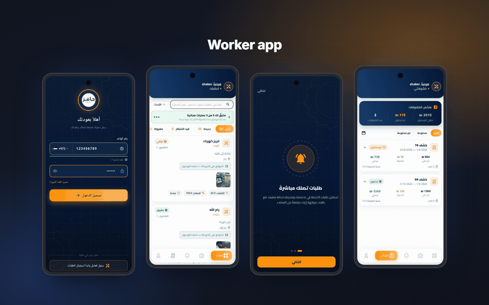
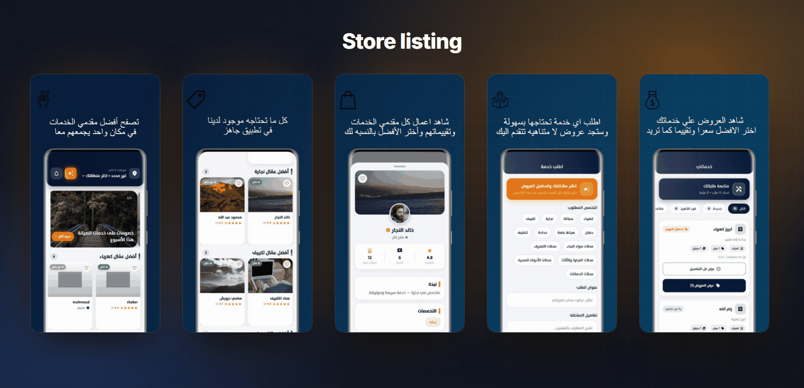
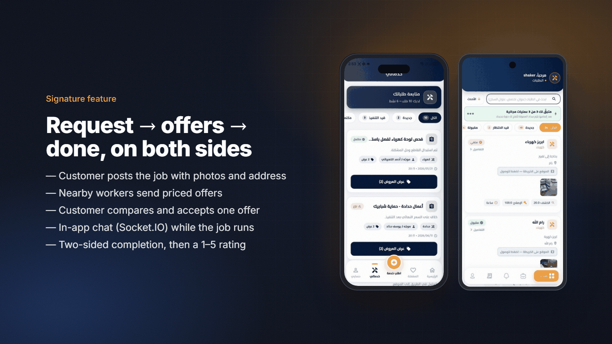
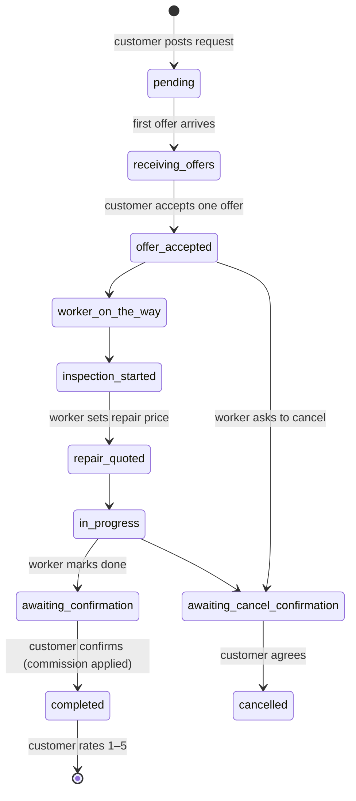
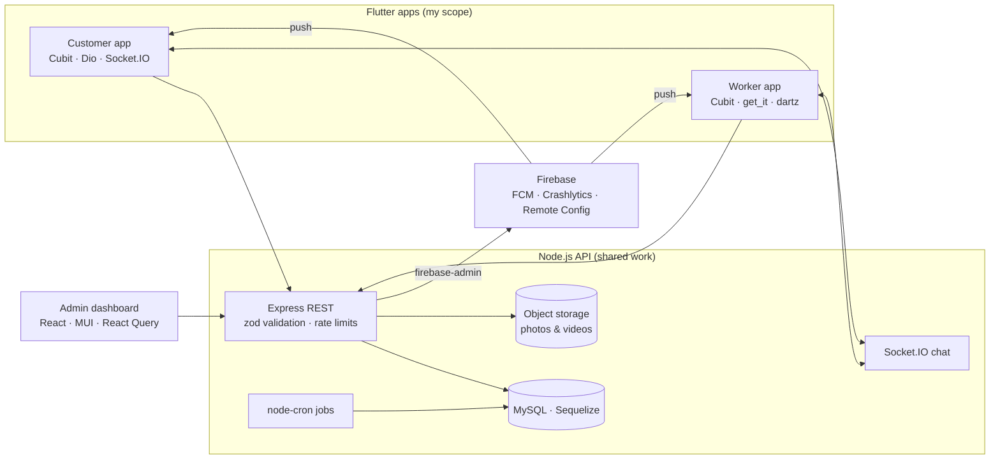

<h1 align="center">Jahiz · جاهز</h1>

<b>A home-services marketplace. Customers describe the job, local workers send real offers, and the work is tracked until both sides confirm it is done.</b>

  
  
  
  
  
  
   
  
  
  
  

> ℹ️ This is a case study. The source code belongs to the client and is not included.

## Overview

**Jahiz (جاهز, "ready")** connects households in Palestine with trusted local tradespeople across eight trades: electricians, plumbers, AC technicians, carpenters, painters, metalworkers, cleaners and general maintenance. It uses a reverse-auction flow instead of fixed prices:

1. The customer posts a job with photos and an address.
2. Available workers in that city and area send offers. Each offer has an inspection fee, a repair estimate and an arrival time.
3. The customer compares the offers and picks one.
4. Both sides chat in-app while the job runs.
5. The job closes only when **both** the worker and the customer confirm it is done. The customer then rates the worker.

**My role:**
- **Lead Flutter developer** for both mobile apps: the customer app (`com.jahiz.userApp`) and the worker app (`com.jahiz.worker`).
- **Backend contributor** on the Node.js API, working alongside another backend developer. My API work included:
  - in-app chat and two-sided job completion
  - targeted notifications, favorites and app-version checks
  - the AI assistant endpoint
  - security hardening: auth, OTP and rate limiting
  - guest browsing, and letting one account act as both customer and worker
- I also made fixes to the React admin dashboard.

The apps were released in August 2026.

## The challenge

- **Trust in an informal market.** Hiring a tradesperson in the region is usually done by word of mouth. Prices are opaque and there is no record after the job. Jahiz had to make offers, profiles, portfolios and ratings visible.
- **Two sides with different incentives.** A job can't be marked "done" by one side alone, and cancellations and price changes need the other side's agreement.
- **A fair model for workers.** Workers start with a number of free jobs, then pay a commission. Statements have to show what was earned, what is owed and what has been paid.
- **Real-time without extra cost.** Customers and workers need to chat about a job and get pushes the moment an offer arrives.

## Highlights

**🏠 Customer app**
- City and area setup on first launch. The home screen shows the best-rated workers per trade, a banner carousel and a reels feed.
- **Request a service** by picking the trade, describing the problem and adding photos and an address from the map. The request is broadcast to matching workers.
- **My services:** a timeline of each request with offer counts, an offer comparison sheet, agreement terms, confirm-complete and confirm-cancel steps.
- **Worker profiles** with bio, specialties, portfolio, years of experience and reviews. Profiles open from deep links and can be shared.
- Per-request chat over Socket.IO, FCM push notifications, favorites, and 1–5 star ratings with comments.
- An AI assistant chat for describing a problem. Guest browsing, OTP phone login and social sign-in.
- Arabic-first UI with English and Turkish translations, light and dark themes, and a forced-update check.

**🧰 Worker app**
- Phone login, onboarding, and a requests inbox filtered by status (new, pending, accepted) with search.
- Send an offer with inspection fee, repair price and arrival time. A banner tracks the free jobs remaining.
- Request details with a map link, cancel-with-reason and price-change requests.
- **Statements:** earnings, commission and paid or unpaid status for each billing period.
- Portfolio ("my works"), reviews, notifications and chat with customers.

## Screens

Customer app: splash, home (top workers per trade), request a service and my services with offers.

Worker app: phone login, requests inbox, onboarding and statements.

Google Play listing artwork for the customer app.

## Signature feature: request → offers → done, on both sides

A request moves through a state machine that both apps show consistently:

- **Offers** carry an inspection fee, a repair estimate and an ETA. The customer sees them side by side in a sheet and accepts one, along with clear terms.
- **Completion and cancellation need both sides.** The worker can only move a job to *awaiting confirmation*. It becomes *completed* when the customer confirms, and that is when the commission applies. A worker's cancellation or repair-price change also waits for the customer's approval. If a job is cancelled after the inspection has started, the inspection fee is still due.
- **Chat is scoped to the request.** Both apps connect with the user's token in the Socket.IO handshake and join a per-user room. Messages and status changes arrive live.

## Architecture & stack

| Layer | Tech |
|---|---|
| Customer app | Flutter, `flutter_bloc` (Cubits), `dio`, `socket_io_client`, `google_maps_flutter`, `geolocator`, `easy_localization` (ar / en / tr), `pin_code_fields`, Google, Apple and Facebook sign-in, `app_links`, `video_player`, `lottie` |
| Worker app | Flutter, `flutter_bloc` with `get_it` service locator, `dartz` `Either` repositories, `equatable`, `pinput`, feature folders (`cubit / data / views`) |
| Push & telemetry | Firebase Cloud Messaging, `flutter_local_notifications`, Crashlytics, Analytics, Remote Config |
| Backend | Node.js, Express 4, Sequelize + MySQL, Socket.IO 4, firebase-admin, multer-s3, zod, node-cron, winston |
| Admin | React 18, MUI, PrimeReact, Redux Toolkit, React Query |
| Theming | Brand tokens in navy `#001232` and amber `#FF9106`, light and dark token sets, Tajawal Arabic font |

## Engineering notes

- **A 403 must not log the user out.**
  - The old Dio interceptor cleared the session on both 401 and 403.
  - A customer account calling a worker-only endpoint gets a 403 even with a perfectly valid token, so users were being silently signed out.
  - The interceptor now ends the session **only on 401**, meaning the token itself is missing, revoked or expired.
  - The 401 handler is single-flight, so a screen that fires several requests at once triggers one logout, not many.
- **One account, two roles.** I extended the backend so a single phone number can be both a customer and a worker. Both apps handle role-specific errors without breaking the session.
- **Two-sided completion and cancellation.** These are new request states, enforced on the server and shown in both apps' timelines. The other party gets a targeted push and confirms in one tap.
- **Fair-usage gating.** The worker app shows remaining free jobs before each offer and the commission owed per statement period, so the business model is visible and not a surprise.
- **Worker app built on the delivery platform's restaurant app.** The worker app started from the Talabatek restaurant app's clean-architecture shell (`get_it`, `dartz`, feature folders). Reusing it cut setup time, and the code was then reshaped around requests, offers, statements and portfolios.

## Results

- **2 Flutter apps live on both stores** since August 2026:
  - Customer app: [Google Play](https://play.google.com/store/apps/details?id=com.jahiz.userApp) (10+ installs at the time of writing) and the [App Store](https://apps.apple.com/sa/app/id6797543538).
  - Worker app: [Google Play](https://play.google.com/store/apps/details?id=com.jahiz.worker) (10+ installs at the time of writing) and the [App Store](https://apps.apple.com/sa/app/id6798863864).
- These are early-stage launches, so the store install figures are small and are reported as-is.

## Part of a white-label platform

Jahiz reuses the foundations of a delivery platform that was redeployed for three brands, each with its own identity:

| Repo | Brand | What it shows |
|---|---|---|
| [talabatek-case-study](https://github.com/ANaSHaker/talabatek-case-study) | Talabatek · طلباتك | The original food and grocery delivery platform: customer, driver, restaurant and web apps |
| [oneway-case-study](https://github.com/ANaSHaker/oneway-case-study) | OneWay Fast Food | A white-label redeployment with a new brand kit, golden tests and adaptive live location |
| **[gahez-case-study](https://github.com/ANaSHaker/gahez-case-study)** | Jahiz · جاهز (this repo) | The same foundations reshaped into a home-services marketplace |

## بالعربي

**جاهز** سوق خدمات منزلية في فلسطين يربط الناس بالحرفيين: كهرباء، سباكة، تكييف، نجارة، دهان وغيرها.
العميل يصف المشكلة ويضيف صورًا وعنوانًا، فتصله عروض حقيقية من الحرفيين (أجرة الكشف، تكلفة الإصلاح، موعد الوصول)، ويختار الأنسب، ويتابع التنفيذ بالمحادثة داخل التطبيق.
لا يُغلق الطلب ولا يُلغى إلا بموافقة الطرفين، ثم يقيّم العميل الحرفي.
دوري: مطوّر Flutter رئيسي لتطبيق العميل وتطبيق الحرفي، إلى جانب مساهمات في الـ API: المحادثة، والإنهاء بموافقة الطرفين، والإشعارات الموجّهة، وتأمين تسجيل الدخول وOTP.
التطبيقان منشوران على Google Play وApp Store منذ أغسطس 2026.

## Links

- Customer app: [Google Play](https://play.google.com/store/apps/details?id=com.jahiz.userApp) · [App Store](https://apps.apple.com/sa/app/id6797543538)
- Worker app: [Google Play](https://play.google.com/store/apps/details?id=com.jahiz.worker) · [App Store](https://apps.apple.com/sa/app/id6798863864)

---
<h3 align="center">Built by Mahmoud Shaker — Senior Flutter Engineer</h3>

  
  
  
  
  
  
  

